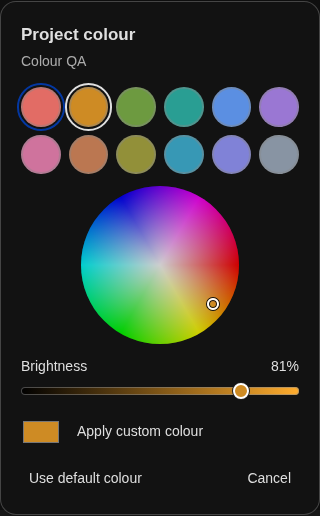
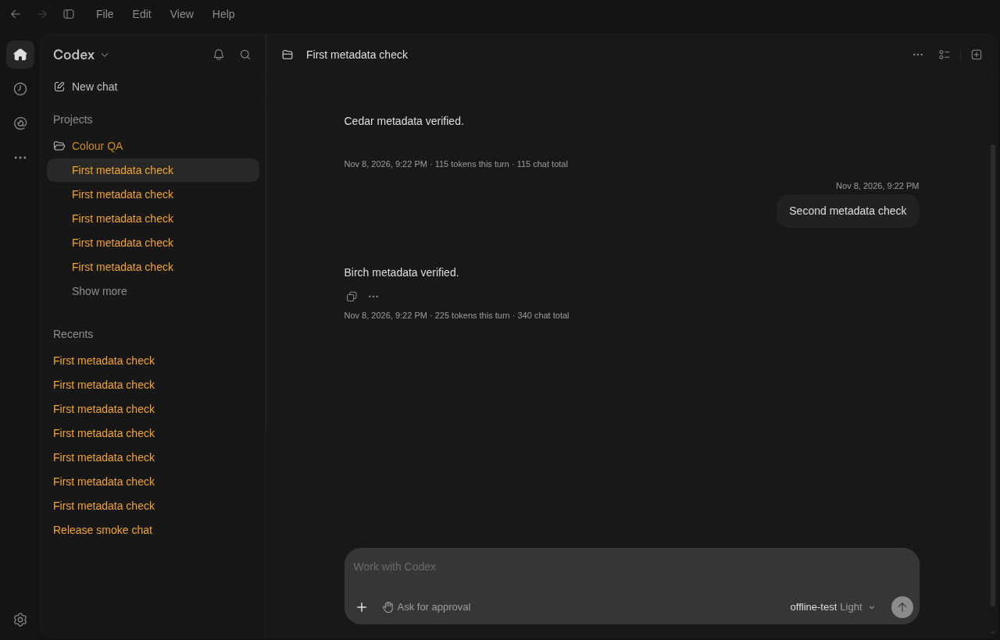

# Codex Desktop Mods

<!-- activation-badges -->
<!-- /activation-badges -->

All three plugins support optional **reported activations**. After a successful first use with a configured counter, you can choose **Count this installation** or **Skip**. Counting sends the plugin name and a random receipt to the address shown. Each profile counts once per plugin at that address. The marketplace ships ready to self-host. [Counter setup and privacy](counter/README.md)

Unofficial mods for the Windows and Linux ChatGPT desktop apps with Codex. They colour sidebar titles, add timestamps and token counts, and give wide chats more room with a dock for your selected pet.

Windows support targets desktop version `26.1103.32239` (Store package `OpenAI.Codex 26.1103.4239.0`, x64). Tested with Linux desktop builds `26.1027.51404`, `26.1029.61003`, `26.1103.31037`, `26.1103.32239` and `26.1103.60933` installed at `/usr/lib/chatgpt`. The visual mods install together. For chat history across computers, install **Codex Chat Sync** separately from the same marketplace.

## Install from Plugin Explorer

1. Open **Plugins → Add → Add marketplace**, choose the repository option and enter `https://github.com/Capronicus/codex-desktop-mods`.
2. Select **Capronicus Desktop Mods** in the marketplace picker, then install **Codex Desktop Mods**.
3. Open a new chat with the plugin and ask **Apply the desktop mods**. The plugin's local tools require Python 3.9 or later on PATH as `python3`. Chat Sync needs Python 3.10 or later. On Windows, if `py -3` works but `python3` opens the Store, run `py -3 setup_windows_python.py` from the extracted repository. This adds a second executable name beside your per-user Python interpreter. Plugin updates can then use the shipped manifests. If ChatGPT was already open, switch Chat Sync off and on in Settings > Plugins to refresh discovery.
4. Fully quit ChatGPT, including its tray window. On Windows, open **ChatGPT (Desktop Mods)** from Start. On Linux, open **ChatGPT** from the applications menu.

For the command-line marketplace workflow, run:

```sh
codex plugin marketplace add Capronicus/codex-desktop-mods
codex plugin add codex-desktop-mods@capronicus-desktop-mods
```

## Mod Controls

Right-click the pet in the chat margin or its floating window and choose **Mod Controls**. The panel opens in the main window. This shortcut needs **Codex Chat Sync** from the same marketplace.

If the pet menu shows only **Select All**, update **Codex Desktop Mods** to 0.11.0 or later and ask it to **Apply the desktop mods**. Fully quit ChatGPT, including the tray icon, then reopen it using the launcher in step 4 above.

Open **Chat sync → Device name and emoji** on each connected desktop. For example, set **🏠 Home** on one and **💼 Work** on the other. After sync, Desktop Mods 0.10.0 shows the origin emoji in the sidebar and the device name by the chat composer. Older histories can show **First seen on** when the original device is uncertain. Referenced local files still live on the computer where you saved them.

If a chat stays stuck during transfer, open **Sync folder health → Check folder**. For missing or damaged blocks, choose **Repair from this desktop** on a computer with a complete copy. Let your folder client finish, then check again on the receiving desktop.

Install **Codex Chat Sync** from the same marketplace, then open **Mod Controls** in the desktop sidebar. You can also ask Chat Sync to **Open Mod Controls**. The panel shows the last sync attempt, the last full success, and how many current chat revisions another desktop has acknowledged. **Pause sync** preserves the device name, sharing choices and local-only rules.

The six appearance switches work without connecting a folder.

## Bookmarks, saved views and cross-device sidebar tools

- Right-click a chat message or a selected phrase and choose **Bookmark message** or **Bookmark selection**. Give it a name in Mod Controls. Right-click the pet and choose **Bookmarks** to return to it. A changed phrase falls back to its message.
- Open **Saved views** at the top of the sidebar. Choose **New view** to combine a local project, origin device, last update and outstanding receipt. For example, save **Work this week** or **Tartarus awaiting Home**. Matches open the original local chats. An unknown origin cannot match a device filter. Bookmarks and saved views stay on this desktop.
- In **Mod Controls → Organize projects and sections**, use **Add to batch** to create nested groups, move sections or move several chats together. Preview the list, choose **Apply batch on quit**, then fully quit and reopen once.
- To share nesting, enable **Projects and sections** and **Subsection tree** in Mod Controls on each participating desktop. Parent links use shared group IDs. Each PC keeps its linked checkout path.
- When handing off a reply, optionally include a project file. The receiving PC can compare its linked copy and see **Same version**, **Changed here** or **Missing here**. The handoff includes the project-relative path and a SHA-256 fingerprint. File contents stay in their respective checkouts.

## Project subsections and group conversions

With **Codex Desktop Mods** and **Codex Chat Sync 0.15.0** installed on this desktop, right-click a local project or a custom section and choose **Organize project…** or **Organize section…**. The same controls are in **Mod Controls → Organize projects and sections**. These local actions work with chat sync disconnected.

- Choose **Create subsection** to add a named group inside a project or custom section. The sidebar supports three levels, such as **Studio › Design › References**. A subsection collapses with either parent. Use the usual section menu to add chats.
- Choose **Convert section to project** to create a real local Codex project and move its local chats there. You can supply a folder. A previously demoted project restores its saved folder paths.
- Choose **Convert project to section** and select **Top-level sections**, a local project, or a custom section with room for the group and its children. **Move section** also moves an existing section between those locations. Cloud items in a promoted mixed section stay together in a subsection.

Click **Save change**, fully quit the desktop (including its tray window), and reopen it. The conversion uses Codex's project and chat APIs. Parent placement and remembered folder paths are specific to this desktop.

## Animated words in chat

Select words in a chat message, right-click the selection, and choose **Animate selected text**. The selected occurrence gets a gently pulsing highlight. Select any part of it and choose **Remove text animation** to clear it. This works in local Codex and ChatGPT messages, including your own. The marks are saved on this desktop and leave the message and copied text intact. With reduced motion enabled, the highlight stays still.

## Files, reply handoffs and chat actions

Update **Codex Desktop Mods** and **Codex Chat Sync** to **0.15.0** on both PCs, apply the desktop mods, then fully quit and reopen the app. Right-click a local assistant reply for **Open local copy** or **Hand off this reply**. Shift + right-click keeps the regular text menu. Right-click a local sidebar chat for **Chat branches** or a project for **Project sharing**.

Open **Mod Controls → Chat actions and sharing** for the handoff inbox, conflict comparison, project or folder exclusions and the 12-second desktop responsiveness check. [Using chat actions on Home and Work](plugins/chat-sync/README.md#chat-actions-on-home-and-work)

## Install Chat Organizer on Windows or Linux

In **Plugins**, refresh the **Capronicus Desktop Mods** marketplace. To add it for the first time, choose **Add → Add marketplace** and enter `https://github.com/Capronicus/codex-desktop-mods`. Select **Chat Organizer** and click **Install**. In a new chat, select the plugin and ask **“Preview a cleanup of my sidebar.”**

Chat Organizer uses the sidebar actions built into Codex desktop. It installs independently and needs no desktop patch, Python or sync folder. Read the [Chat Organizer guide](plugins/chat-organizer/README.md) for examples.

## Sync chats between desktops

Refresh **Capronicus Desktop Mods** in Plugin Explorer on each desktop and install **Codex Chat Sync**. Open a new chat and ask **Check chat sync status**. To connect a device, choose the local path to the same private, available-offline folder in Nextcloud, OneDrive or Google Drive. Each computer can use a different path. Installation starts disconnected.

With Desktop Mods and Chat Sync installed on both computers, ask each desktop to **enable colour sync and sync my colours now**. This exchanges chat, project and section colours, saved swatches and group overrides using the configured private folder.

Chat Sync 0.5.0 can also sync appearance and chat preferences, including themes, fonts, composer behaviour and chat detail level. [Set up settings sync](plugins/chat-sync/README.md#sync-appearance-and-chat-preferences).

Chat Sync 0.3.0 also offers **Enable sidebar sync**. Enable it on each participating desktop to exchange local project and custom section names and the project and section of each synced Codex chat. Choose a project folder separately on each computer.

Chat Sync 0.4.0 adds explicit project linking to local checkouts, per-chat delivery receipts, local-only rules for projects and chats, sidebar merge previews and undo, and an optional shared pin order and project/section order. Desktop Mods 0.7.0 shows the origin device and receipt status when you hover over a local chat title.

Read the [setup and conflict recovery guide](plugins/chat-sync/README.md).

## Windows

The launcher discovers the registered Microsoft Store package and stages a private app copy under `%LOCALAPPDATA%\OpenAI\Capronicus\CodexDesktopMods`. Allow several GB of free space. It updates the archive integrity hash in the copied executable, which changes its Microsoft Store signature. The signed Store installation stays available through the original **ChatGPT** shortcut. Computers managed by an application-control policy may block the modified copy.

Starting **ChatGPT (Desktop Mods)** checks for Store updates, rebuilds a compatible copy, and starts it with the installed package identity. An incompatible update opens the standard app and reports the reason. To remove the shortcut and cache, quit the modded app and ask the plugin to **Remove the desktop mods**.

For manual installation, download and extract this repository, open PowerShell in the extracted folder and run `py -3 windows_mods.py install`. Use `py -3 windows_mods.py status` to check it or `py -3 windows_mods.py uninstall` to remove it.

## Sidebar colours

Right-click a project, chat or custom section heading and choose **Project colour…**, **Chat colour…** or **Section colour…**. Shift + right-click opens the picker directly. A preset applies immediately. For a custom colour, drag around the wheel to pick a hue, move toward the centre for less saturation, then set the **Brightness** bar and click **Apply custom colour**. With the wheel focused, Left and Right adjust hue and Up and Down adjust saturation. Hold Shift for larger steps.



- A project’s chats inherit its colour, including when they appear in Recents. Pick a colour for one chat to override it, or choose **Use project colour** to restore inheritance.
- A custom section colours its heading and any chats with no individual or project colour. Resetting an override restores the next colour in that order. The section colour follows its members into Recents.
- Enable **Override all chat colours** in a project or section picker to give all its chats the group colour, including chats in Recents and future members. Switch it off to save the group’s current colour to each member chat. You can then recolour individual chats. A section override takes priority when both groups have one.
- Use the wheel and **Save swatch** to keep a colour for any picker. Click a saved swatch to apply it. Use **Remove…** in Saved colours to delete one.
- A thin line in the sidebar gutter joins a local chat to its branch when both are visible in the same list. It reads the saved parent ID and follows the native sidebar order.
- The project title keeps its chosen colour. For the first day after an update, a chat title shows its exact project colour or its individual override. It gradually dims to 75% brightness by day 14, keeping the same hue.
- A thin outline marks pinned chats in light and dark themes.

## Timestamps and token use

Messages show their local date and time when the chat history provides a timestamp. On a completed Codex turn, **225 tokens this turn · 340 chat total** means the model used 225 input and output tokens across the calls for that turn, bringing the recorded conversation total to 340. Reopening the chat shows the counts through each reply. Regular ChatGPT conversations show timestamps when available.

The mod reads usage from both plain and compressed local Codex histories. Reopening a compressed chat shows its recorded timestamps and token counts. Missing usage stays blank.



## Wider chats and the pet dock

On wide windows the messages and composer expand together, leaving the Sources and Outputs card clear. Your selected pet sits in the right margin and runs in place as you scroll. Scrolling down makes it run right, scrolling up makes it run left, and it settles when scrolling stops. The dock gives way when the window gets narrow.

Click the pet to open its floating window, or summon it with the usual desktop pet command. Closing that window returns it to the chat. The dock uses the desktop’s selected artwork and respects reduced motion.

## Manual Linux installation

Use Python 3 on Linux. Allow approximately 1 GB of free space for the cached app copy. Download and extract the repository, then run this from the extracted folder as your normal user.

```sh
python3 sidebar-colours.py install
```

Fully quit ChatGPT, then reopen **ChatGPT** from your applications menu. The launcher runs the patched copy under your user cache. Your colours stay in the desktop profile. To upgrade from an earlier release, run the same install command from the new download once.

## Linux desktop updates

After the package manager updates ChatGPT, open **ChatGPT** from the applications menu as usual. On the first launch, the mods check the new package and rebuild the cached copy if the required app components are compatible. Later launches reuse that copy.

If an update changes an integration the mods depend on, the launcher opens stock ChatGPT and reports the reason. Your colours stay saved. The launcher checks again when the desktop package changes. To pick up support added in a newer mod release, download it and rerun the install command.

## Remove or recover on Linux

Fully quit ChatGPT. From the extracted folder, run the following command and reopen ChatGPT from the applications menu.

```sh
python3 sidebar-colours.py uninstall
```

If you already removed the download, use the installed script.

```sh
python3 "${XDG_DATA_HOME:-$HOME/.local/share}/codex-sidebar-colours/sidebar-colours.py" uninstall
```

To start the stock app directly after quitting the modded instance, run `/usr/bin/chatgpt`.

## Tests

Run the history reader and launcher tests from the repository folder. They use synthetic chat history and disposable desktop packages.

```sh
node tests/chat-details.cjs
python3 tests/updates.py
```

With the Linux desktop app and Google Chrome installed, run `node tests/sidebar-colours.cjs` to check the rendered colours in both themes, `node tests/sections.cjs` for section inheritance and `node tests/chat-layout.cjs` to check chat width, panel clearance and scroll behaviour. Run `node tests/saved-views.cjs` for the sidebar view editor and receipt filters. Run `node tests/animated-words.cjs` to check the selected occurrence, persistence and reduced motion.
